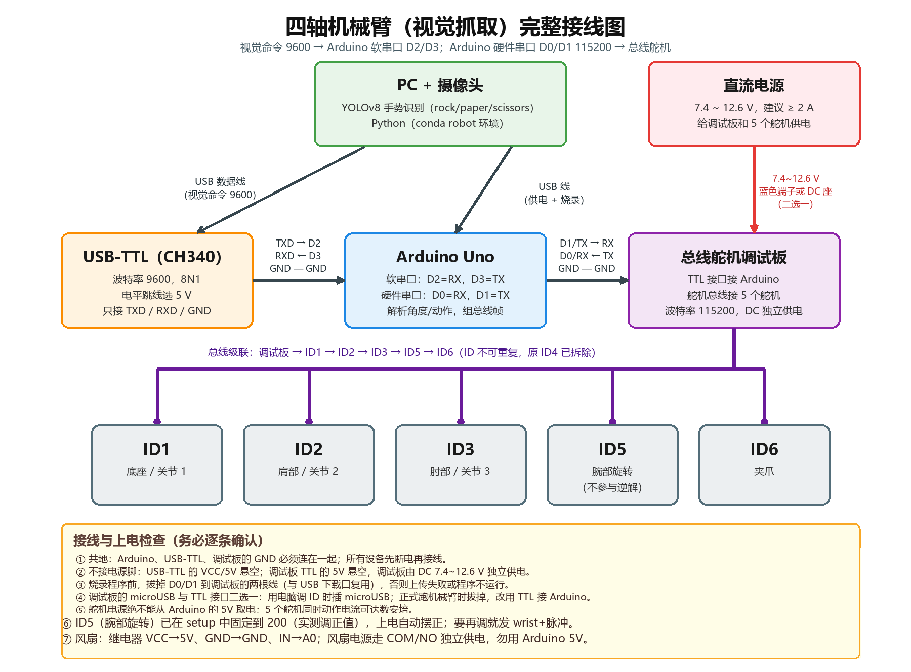
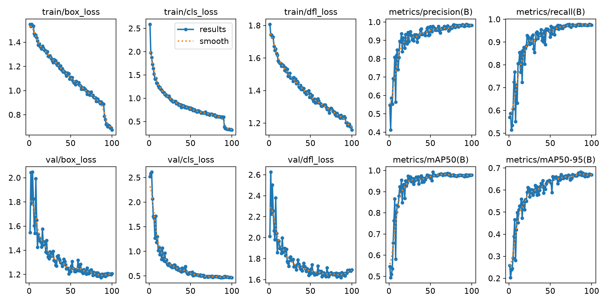
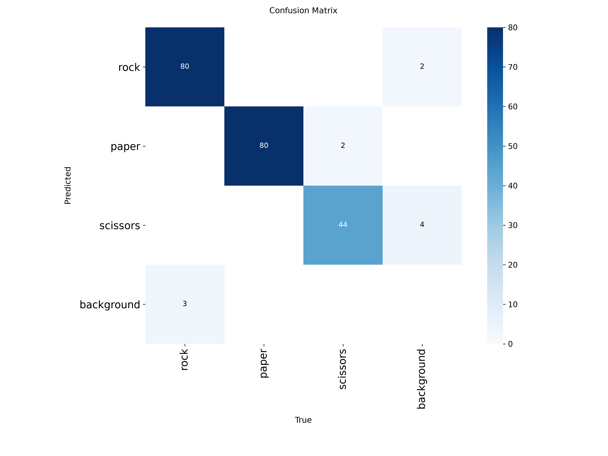
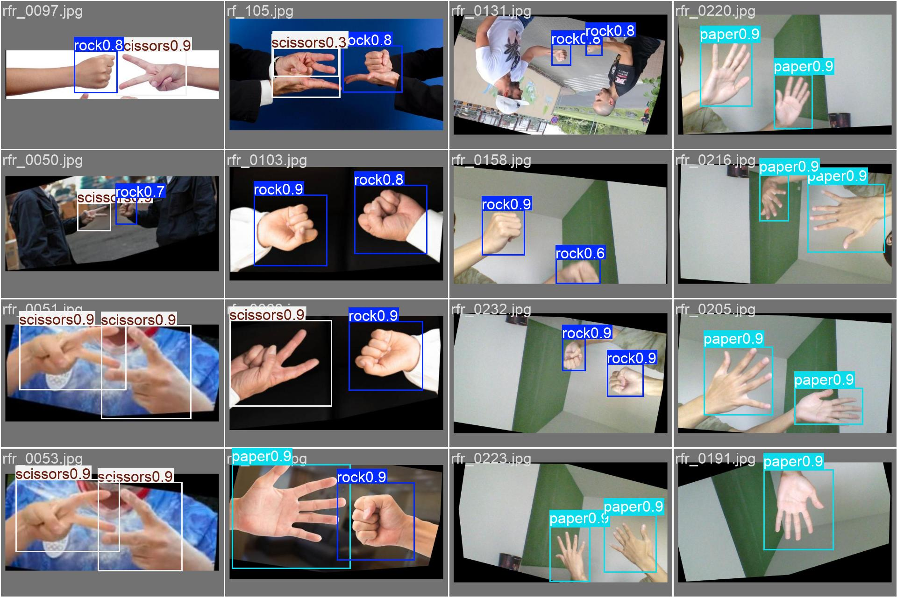

# AI 自主型机器人系统构建 · 课程项目

哈尔滨工业大学（深圳）跨专业选修课《AI 自主型机器人系统构建》的项目代码。

一条完整的链路：**摄像头 → YOLOv8 视觉识别 → USB-TTL 串口 → Arduino Uno → 四轴总线舵机机械臂 / 继电器风扇**。

| 实验 | 内容 | 触发方式 |
| --- | --- | --- |
| 实验 1 | 人脸检测 + 舵机联动 | 识别到目标人脸 |
| 实验 2 | 手势识别 → 四轴机械臂抓取、夹爪展示、风扇控制 | 石头 ✊ / 布 ✋ / 剪刀 ✌️ |

上位机只负责**视觉识别和动作编排**，运动学解算、指令解析、舵机时序全部放在下位机 —— 这是课程要求的分工，也让视觉部分可以单独替换。

---

## 系统结构



- **上位机**：PC + 摄像头，Python + ultralytics，输出文本命令
- **下位机**：Arduino Uno
  - 硬件串口 D0/D1（115200）→ 总线舵机调试板
  - 软串口 D2/D3（9600）→ USB-TTL（CH340）
  - A0 → 继电器模块 → 直流风扇
- **执行器**：总线舵机 ID1 底座 / ID2 大臂 / ID3 小臂 / ID5 腕旋 / ID6 夹爪

> Uno 只有一个硬件串口且与 USB 下载口复用，所以舵机走硬件串口、上位机走 SoftwareSerial。代价是烧录时要拔掉调试板的 D0/D1。

---

## 目录

```
arduino/
  arduino_grab.ino      四轴臂固件：命令分发、正逆运动学、舵机帧、三套动作
  gesture_vision.ino    早期单手版：手势 → 单个舵机 / 风扇（保留作对比）
pc/
  gesture_serial.py     实验 2 主程序：手势识别 → 动作序列 → 串口
  grab_gui.py           坐标系 Tk 界面：直接发 x,y,z 让下位机逆解
  face_vision_serial.py 实验 1：人脸识别 → 舵机
scripts/
  download_gesture_dataset.py  下载 HF 镜像的石头剪刀布数据集
  make_clean_split.py          NCC 去重后重新划分 train/val
  fix_missing_labels.py        补全缺失的标注
cpp/arm_control/        C++ 版上位机（Visual Studio 工程，运动学 + 串口）
data/                   数据集 yaml 模板（path 需改成自己的路径）
models/                 gesture_best.pt / face_best.pt
media/                  训练曲线、混淆矩阵、验证集预测
docs/                   两份本机适配教程 + 接线图
```

---

## 快速开始

### 1. 环境

- Python 3.12，`torch` + `ultralytics` + `opencv-python` + `pyserial`
- Arduino IDE，开发板选 Arduino Uno

### 2. 烧录固件

用 Arduino IDE 打开 `arduino/arduino_grab.ino`，选 Uno 和对应串口，编译下载（下载前拔掉 D0/D1 上的调试板）。

上电后固件会：硬件串口 115200 初始化 → 回一行 `READY` → 腕旋舵机 ID5 摆到正位 → A0 置低（风扇关闭）。

### 3. 运行上位机

```bash
python pc/gesture_serial.py --list-ports      # 查 USB-TTL 的串口号
python pc/gesture_serial.py --dry-run         # 不接串口，只看识别
python pc/gesture_serial.py --port COM5       # 正式运行
```

不接摄像头时可先验证串口链路：

```bash
python pc/gesture_serial.py --port COM5 --test-serial --test-action rock
```

### 4. 三种手势对应的动作

| 手势 | 动作序列 |
| --- | --- |
| 石头 ✊ | 到抓取点 `(45,45,90)` → `grab` → 抬高 `(45,30,60)` → 同高度移动 `(0,45,90)` → `release` → `reback` |
| 剪刀 ✌️ | `reback` → 直角展示位 `(0,0,90)` → `show`（夹爪开合五次）→ `reback` |
| 布 ✋ | `fan` → 等 5 s → `fanoff` |

每条命令默认间隔 3 s，动作结束冷却 3 s，避免同一手势被重复触发（`--hold`、`--cooldown` 可调）。

---

## 串口协议

ASCII 文本行协议，9600 8N1，每条命令以 `\n` 结尾，不校验前缀。

| 命令 | 说明 | 回传 |
| --- | --- | --- |
| `gesture+θ1+θ2+θ3` | 三个关节角（度），下位机做正解→反解→脉冲 | `OK p1,p2,p3` + `DONE` |
| `x,y,z` | 末端坐标（mm），下位机逆解后执行 | `OK` + `DONE` |
| `grab` / `release` | 夹爪闭合 2900 / 张开 1700 | `DONE` |
| `reback` | 三轴回中 2000、张开夹爪、关风扇 | `DONE` |
| `show` | 夹爪「张开—夹紧」五组循环 | `DONE` |
| `fan` / `fanoff` | A0 高 / 低电平 | `DONE` |
| `read5` / `wrist+脉冲` | 读 / 写腕旋舵机 ID5 | `POS5` / `OK5` |
| 非法参数 | 角度越界、脉冲越界、格式错误、命令超长 | `ERR:range` / `ERR:travel` / `ERR:format` / `ERR:too_long` |

**角度约定**：θ1、θ2 ∈ [-90°, 90°]，θ3 ∈ [0°, 135°]。下位机把角度做一次「正运动学 → 逆运动学」往返，保证上位机给的角度对应机构实际能到达的姿态。

---

## 运动学

连杆参数 A1 = 108 mm、A2 = 82.5 mm、A3 = 150 mm，末端用极坐标 (R, z) 描述：

```
R = A2·sinθ2 + A3·sin(θ2+θ3)
z = A1 + A2·cosθ2 + A3·cos(θ2+θ3)
```

角度到脉冲线性映射（行程 96~4000，中位 2048）：

```
p1 = 2200(θ1+90)/180 + 850
p2 = 2150(θ2+90)/180 + 950
p3 = 2200(θ3+90)/180 + 950
```

抓取点与放置点末端高度都约 60 mm，只把底座从 45° 转到 0°，末端沿同高度圆弧平移 —— 比老师示例里「放置点高 119 mm」的方案动作更连贯。

---

## 训练

数据集用 Roboflow RPS v3 的 YOLO 版本（CC BY 4.0）。原始划分存在同源图片泄漏，脚本用 32×32 NCC（含水平翻转，≥0.8 视为同源）聚组后重新划分，最终 1427 train / 158 val。

```bash
python scripts/download_gesture_dataset.py
python scripts/make_clean_split.py
yolo detect train data=data/gesture_dataset.yaml model=yolov8n.pt epochs=100 imgsz=640 amp=False
```

> `amp=False` 是必须的：本机（RTX 5070 Laptop，sm_120）学习率自检需要联网下载 `yolo26n.pt`，会一直超时重试。

训练结果：Precision 0.981 / Recall 0.973 / mAP50 0.977 / mAP50-95 0.682。

| 训练曲线 | 混淆矩阵 | 验证集预测 |
| --- | --- | --- |
|  |  |  |

实验 1 的人脸检测模型同源流程，见 `media/face_*.png` 与 `docs/YOLOv8人脸检测_本机适配教程.md`。

---

## 演示视频

见 [Releases](../../releases)：

- `demo-gesture-arm.mp4`：石头抓取放置 → 剪刀夹爪展示 → 布开风扇
- `demo-face-servo.mp4`：实验 1 人脸检测驱动舵机

---

## 踩坑记录

- **腕旋舵机标定**：课程资料给的是 900 = 0°、2000 = 90°、3100 = 180°，即 1100 脉冲 ≈ 90°；实测夹爪正位在脉冲 200，不是中位 2000。最终写死上电正位，并加了 `read5` / `wrist+脉冲` 两条调试命令。
- **风扇不转**：按「信号 → 继电器 → 负载」三层排查，最后定位到面包板接线错误，不是代码问题。
- **软件串口吃字节**：SoftwareSerial 收数据时会短暂关中断，可能打断舵机应答。所以读位置只在调试时用，正常动作流程不依赖回读。
- **串口资源**：Uno 单硬件串口被舵机占用后，视觉只能走软串口，这也是「上位机只发角度、下位机解算」这套分工的由来。

---

## 参考

- 课程讲义：《德晟串口智能舵机协议 v4.01》《控制总线舵机基本操作方法》
- 数据集：[Roboflow Rock-Paper-Scissors v3](https://universe.roboflow.com/)（CC BY 4.0）
- 模型：YOLOv8n（Ultralytics）

本项目为课程作业，代码以学习交流为目的公开。
